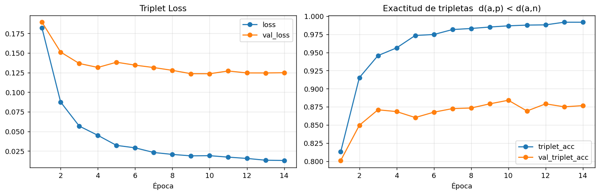
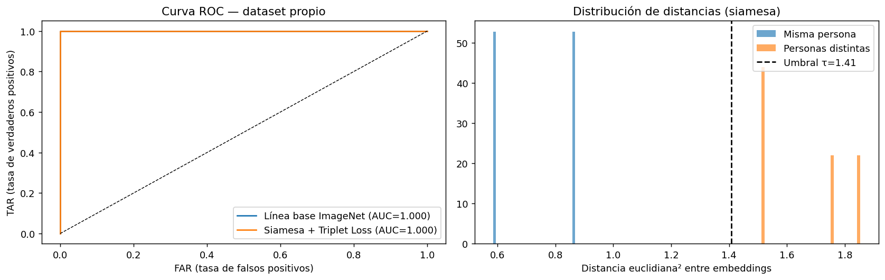

# Redes Neuronales V — Reconocimiento facial con Redes Siamesas y Triplet Loss

Implementación en **TensorFlow 2 + Keras 3** de una red neuronal siamesa de tres ramas (ancla, positivo, negativo)
entrenada con **Triplet Loss** para verificación e identificación facial, evaluada con escenarios
**One-shot**, **Few-shot** y de **identidades no vistas (zero-shot)** sobre un dataset propio con consentimiento.

## Contenido

| Archivo | Descripción |
|---|---|
| `siamese_face_recognition.ipynb` | Notebook principal (Google Colab): preprocesamiento, arquitectura, Triplet Loss, entrenamiento y evaluación. |
| `docs/consentimiento_plantilla.md` | Plantilla de consentimiento informado para el uso académico de fotografías. |
| `results/` | Figuras y `resultados.json` exportados por el notebook (sin fotos originales). |
| `requirements.txt` | Dependencias para ejecución local (Colab ya trae casi todas). |

## Pipeline

1. **Preprocesamiento:** orientación EXIF → detección MTCNN → alineación por ojos → recorte con margen →
   CLAHE → 160×160 → escalado a [-1, 1]; control de nitidez (varianza del Laplaciano).
2. **Datos de entrenamiento:** LFW (personas con ≥ 10 fotos), partición entrenamiento/validación por identidad.
3. **Red de embeddings:** MobileNetV2 (ImageNet, fine-tuning parcial) → Dense(128) → normalización L2.
4. **Red siamesa:** tres entradas que comparten la misma red de embeddings → distancias d(a,p), d(a,n).
5. **Pérdida:** `L = max(d(a,p) − d(a,n) + α, 0)`, α = 0.4.
6. **Evaluación en el dataset propio** (nunca usado para entrenar): ROC/AUC, umbral calibrado en LFW,
   identificación One-shot / Few-shot por prototipos, rechazo de desconocidos, PCA de embeddings.

## Resultados (ejecución del 7 nov 2026, GPU T4)

| Prueba | Resultado |
|---|---|
| Entrenamiento (LFW, 3 870 imgs / 135 ids) | 14 épocas, 6.0 min; mejores pesos en época 9 (val_loss 0.1236, val_triplet_acc 0.879) |
| Verificación LFW validación (23 ids no vistas) | AUC 0.893 · umbral τ = 1.408 · TAR 0.865 · FAR 0.232 |
| Dataset propio (2 personas, 4 imgs, nunca vistas) | 6/6 pares correctos · AUC 1.0 |
| One-shot (1 foto de registro por persona) | Exactitud 1.00 |
| Rechazo de personas no registradas | 100 % |

Con solo 4 imágenes propias los resultados no son estadísticamente significativos; la métrica de
generalización representativa es la de LFW validación. Figuras y métricas en [`results/`](results/).

## Cómo ejecutar

1. Abrir el notebook en Colab con el botón de arriba y activar **GPU (T4)**.
2. Preparar `dataset.zip` con la estructura `raw/<persona>/<foto>.jpg` (≥ 3 personas, 8–15 fotos cada una).
3. Ejecutar todas las celdas (`Entorno de ejecución → Ejecutar todas`) y subir el zip cuando se solicite.
4. Al final se descarga `outputs_redes_neuronales_v.zip` con figuras, métricas y el modelo.

## Privacidad y consentimiento

Las fotografías usadas son propias o de personas que autorizaron por escrito su uso con fines académicos
(ver plantilla en `docs/`). **Las fotos originales y procesadas no se publican en este repositorio**
(`dataset/` está en `.gitignore`).

## Referencias

- Schroff, F., Kalenichenko, D., Philbin, J. (2015). *FaceNet: A Unified Embedding for Face Recognition and Clustering*. CVPR.
- Koch, G., Zemel, R., Salakhutdinov, R. (2015). *Siamese Neural Networks for One-shot Image Recognition*. ICML Deep Learning Workshop.
- Zhang, K. et al. (2016). *Joint Face Detection and Alignment Using Multitask Cascaded Convolutional Networks*. IEEE SPL.
- Sandler, M. et al. (2018). *MobileNetV2: Inverted Residuals and Linear Bottlenecks*. CVPR.
- Huang, G. B. et al. (2007). *Labeled Faces in the Wild*. UMass Amherst, Tech. Report 07-49.
